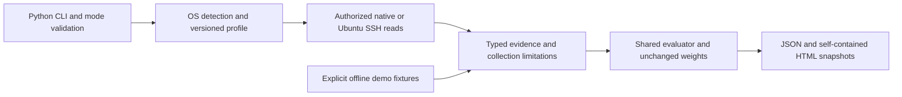

# CyberAssess — Automated Security Baseline Assessment

## Operator handover

Start here when moving to another laptop or handing the tool to another operator.
The official current application is on **`main`**. Record the exact source
commit used for each deployment; use a pinned reviewed commit when reproducing
an earlier handover. [Full operator runbook](handover-runbook.md).

## Product scope and verification

CyberAssess assesses authorized operating-system configurations, evaluates
selected NIST SP 800-53-mapped controls, identifies baseline gaps and generates
JSON and self-contained HTML reports. It supports IT administrators,
cybersecurity analysts, small and medium-sized organizations, authorized
assessment operators, and training or lab environments.

| Capability | Implementation | Verification and operating limits |
| --- | --- | --- |
| Native and Ubuntu SSH evidence collection | Python CLI; Paramiko Ubuntu SSH; native Ubuntu, Windows and macOS reads | CLI/collector/platform suites and three portable demos. Receiving-machine permissions and effective state require authorized live validation. |
| Selected NIST-mapped configuration checks | 15 Ubuntu, 13 Windows and 12 macOS controls in `config/controls.json` and `config/profiles/` | Profile/parser/denial tests and [control coverage](control_master_table.md). This is a limited baseline, not full NIST/CIS coverage or certification. |
| Severity-weighted baseline evaluation | Shared `cyberassess/evaluator.py`; PASS/FAIL/ERROR; High=3, Medium=2, Low=1 | Evaluator and golden regressions. Only PASS earns numerator weight; ERROR represents unavailable evidence and remains in the denominator. |
| Evidence and gap reporting | JSON/HTML snapshots, expected/actual values, severity, NIST references and display-only guidance | Report/provenance/timestamp suites, browser/A4 review and [local/hosted verification](portability-validation.md). Findings require operator interpretation and separately authorized remediation. |

Development origins and earlier requirement traceability are preserved in the
[development history](development-history.md); they are not operating prerequisites.

Test evidence establishes the stated code paths and fixtures, not the security
state of an untested machine. Use the exact source commit and CI run in the
[validation record](portability-validation.md), then complete the checklist below.

## Architecture and technology stack



Live and demo inputs are separate; known demo provenance cannot be promoted to
a live report. Read failures cannot establish a secure default. The technology
stack is Python 3.10–3.13, Paramiko, native PowerShell/macOS/POSIX read utilities,
CoreFoundation via ctypes, JSON, HTML/CSS, pytest, constrained pip dependencies
and a five-job GitHub Actions matrix. There is no database, web service,
continuous monitor, cloud scanner or automatic remediation component.

The legacy `comparison_report.py` is a supplementary Ubuntu lab snapshot
comparison utility, not another collector. Its fixed input filenames require
the operator to supply reviewed before/after JSON. A snapshot transition alone
does not prove remediation or authorization.

## First run on a fresh machine

1. Clone/check out the approved revision, or restore its Git bundle using the
   runbook. Record `git rev-parse HEAD` and the receiving operator's identity.
2. Install Python **3.10–3.13** (3.12 recommended) and Git from approved sources.
   From the repository root, use `sh install.sh` on macOS/Linux or
   `.\install.ps1` on Windows. The helper prepares only local dependencies;
   neither starts collection nor changes security policy. See [setup](setup.md)
   for explicit interpreter/manual installation commands.
3. Use the virtual-environment Python for `-m pip check`, `-m pytest -q`,
   `scripts/check_portability.py`, `main.py --version` and
   `main.py --list-profiles`. Recreate `.venv`; never copy it between machines.
4. Generate the three offline demos below. Confirm both printed report paths
   exist, open HTML in a browser, and compare counts/profile labels with JSON.
5. Review the [validation record](portability-validation.md). Mocked fixtures and
   Linux tests do not establish native Windows/macOS or live SSH validation.

`python` below means `.venv/bin/python` on macOS/Linux or
`.\.venv\Scripts\python.exe` on Windows:

```text
python main.py --demo
python main.py --profile ubuntu --demo --output reports/demo-ubuntu
python main.py --profile windows --demo --output reports/demo-windows
python main.py --profile macos --demo --output reports/demo-macos
```

| Fixture | Controls | PASS / FAIL / ERROR | Score |
| --- | ---: | --- | ---: |
| Original/explicit Ubuntu | 15 | 7 / 8 / 0 | 54.3% |
| Windows | 13 | 9 / 3 / 1 | 70.6% |
| macOS | 12 | 7 / 3 / 2 | 64.3% |

Fixtures are demonstration data. Their findings do not describe the current
machine, and percentages across different profiles are not comparable rankings.

## Before any live collection

- Record the owner's explicit authorization, target, profile/version, operator,
  account context and access window. Installation does not grant permission.
- Ubuntu SSH: complete the [key, host trust and exact passwordless sudo
  preflight](ssh-target-setup.md). No agent, key-passphrase or sudo-password prompt
  is supported. Do not copy private keys into source or handover archives.
- Local profiles: run on the matching authorized native OS. Review [permissions
  and feature limitations](setup.md#live-platform-prerequisites). There is no
  automatic elevation, WinRM or remote macOS collector. In a remote session,
  Python/source/dependencies must be installed on the target and the CLI launched
  there. macOS screen-lock evidence requires the non-root invoking and current
  console user to match. Native effective status is preferred; exact own-user
  configured fallbacks are labelled separately. Blanket root execution cannot
  establish another user's console policy.
- Preserve prior reports. Use a separate `--output` directory per run to avoid
  timestamp collisions, and review every ERROR as unavailable evidence.

```text
python main.py --host TARGET --user AUDITOR --key "PRIVATE_KEY_PATH"
python main.py --profile ubuntu --local --output reports/ubuntu-local
python main.py --profile windows --local --output reports/windows-local
python main.py --profile macos --local --output reports/macos-local
```

Choose the one command matching the approved workflow. `--auto-detect --local`
selects the supported current OS; unsupported distributions fail rather than
being assessed under another baseline. A completed assessment returns 0 even
with FAIL/ERROR findings. Scoring counts every control weight in the denominator;
only PASS earns numerator weight. ERROR is not confirmed noncompliance.

## Review, preview and retain

Keep the exact JSON/HTML paths printed by the CLI together with authorization,
source commit, platform/profile, invoking account, runtime versions and review
outcome. Open HTML directly with `open "REPORT.html"` on macOS,
`xdg-open "REPORT.html"` on a Linux desktop or `Invoke-Item "REPORT.html"` in
Windows PowerShell. No web server is required; transfer files securely from a
headless target. Reports carry sensitive operational evidence and need access
control, review before sharing, retention and backups; HTML filtering is not
complete sanitization. Remediation belongs to a separate approved change,
followed by reassessment.

Acceptance requires passing local dependency/tests/demos and either an approved,
reviewed native/live run or an explicit record that native/live validation is
pending. Escalate unsupported/denied evidence to the owner; do not widen sudo or
weaken host security just to increase the score.

## Final Acceptance Checklist

Use this operational checklist for each deployment or handover. Record the
operator, date, reviewed source and any unverified native checks in the
organization's run record. A pending deployment check does not change the
application's development status or establish a security result.

- [ ] Owner and operator agree the authorized OS-baseline scope and limitations.
- [ ] Exact source commit, clean checkout, receiving operator and fresh
      machine-local virtual environment are recorded.
- [ ] Dependency check, full tests, portability check and all five native CI jobs
      pass for the handed-over source; preserve the exact CI link and test count.
- [ ] Ubuntu/Windows/macOS demos open as samples with 15/13/12 controls; JSON/HTML
      counts, weighted scores, times, evidence and A4 output agree.
- [ ] Target ownership/authorization, profile/version, native tools and account
      context are recorded; SSH keys, host trust and exact sudo reads are verified
      where applicable. No credentials enter the repository or handover archive.
- [ ] Live evidence is reviewed against native administrator-observed state, or
      each unverified platform/permission/model limitation is explicitly accepted.
      MAC-005/MAC-012 are not forced to PASS; missing/denied evidence remains ERROR.
- [ ] Known limitations, snapshot scope, non-certification wording and separately
      authorized remediation/reassessment are understood by the receiving operator.
- [ ] Paired reports, authorization and source/runtime records are retained under
      access control with a working backup. Historical lab artifacts and new
      diagnostics are reviewed for identifiers before any sharing.

Hosted tests verify software regressions and portable demonstrations; they do
not establish a receiving machine's permissions or effective security state.
